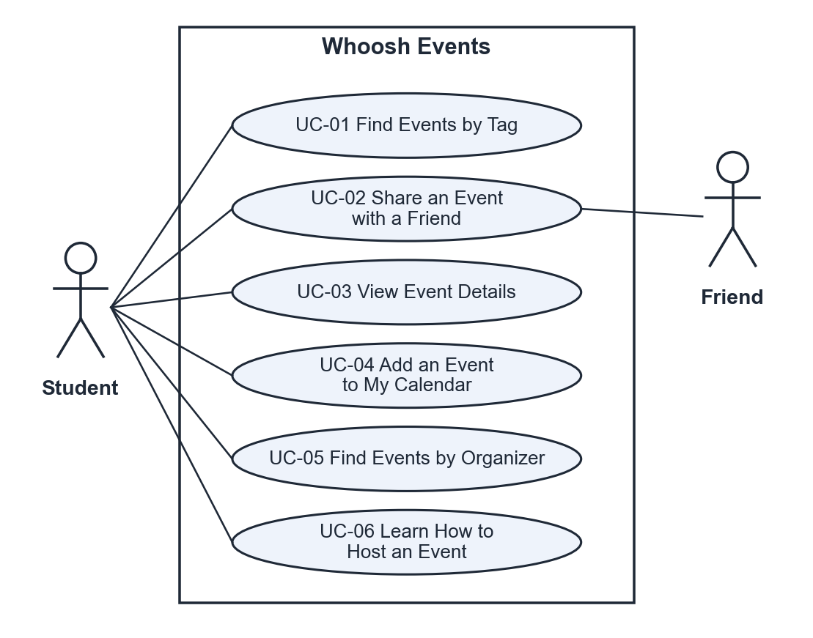
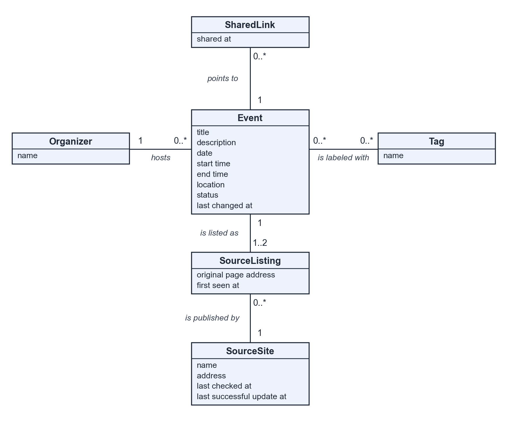
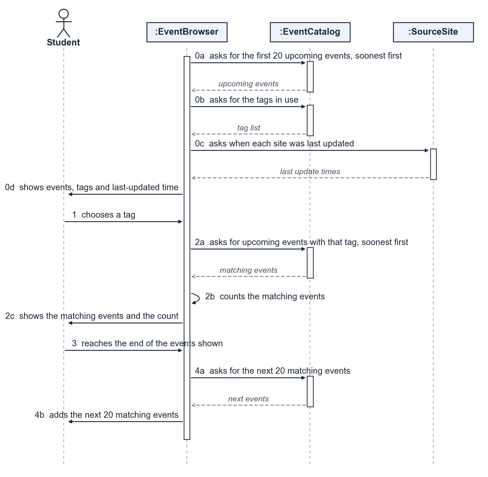
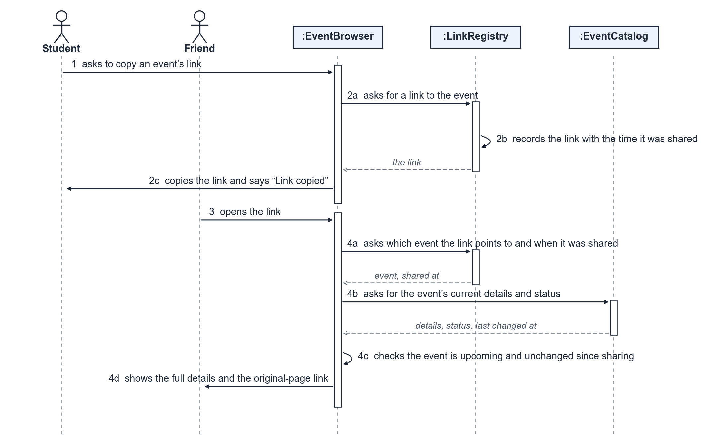

# P2 sections owned by Ahmed Fouad

Final text of the sections below, as committed by their owner. The same text appears in the P2 PDF
in `/docs/p2`. Diagrams and their source are in `../diagrams/`.

---

## 2.2 Stakeholders: Site Users evidence (P1 feedback C1)

**What they need:** One place that shows events from all UTD groups, including ones they do not already
follow, early enough to attend, and filters to find what interests them.

**How we learned this:** Poll of 7 UTD students on Nov 5, 2026 (How do you find out about UTD events?).
Each relies on one channel: Instagram, a club Discord, a WhatsApp free-food group, walking past the Student
Union, MSA announcements, the UTD Calendar or university emails; the official channels carry only academic
and university events, and none mentioned Nebula. One hears of events only after they are over. So students
see only the groups they already follow, and too late.

**Event Organizers, how we learned this:** From the source sites in 1.4: every event names its organizer, and
each site has its own process for posting an event. FR-04 points organizers to that process instead of
replacing it.

**Source-site maintainers, how we learned this:** From the sites' robots.txt files, read in Nov 2026: the UTD
Calendar asks automated readers to wait 1 second between requests, and Nebula allows all pages. CON-03
follows these rules.

## 1.1, 2.1, 2.5, 2.6 P1 leftovers fixed

- 1.1: Whoosh Events gathers UTD's events into one list and shows students where to submit their own
  events on the official source sites (P1 text said students could create events, which contradicted CON-01).
- 2.1 (Figure 2.1, `../diagrams/context_diagram.png`): The boundary surrounds Whoosh Events itself: the event
  collector and the website, which are the only parts we build and maintain. Students and their friends use
  the website from outside the boundary. The UTD Calendar and the Nebula club calendar are external systems
  we only read from, under their robots.txt rules (CON-03); we did not build them and cannot change them.
- 2.5 A1: Every event on the source sites in 1.4 has a readable title, date and start time. If not: an event
  with no date cannot be placed in the list; fields that are only missing show Not listed (FR-07).
- 2.5 A3: if the same event cannot be matched across both sources, it appears twice in the event list,
  which breaks FR-03.
- 2.6 Technical evidence: the UTD Calendar also offers a public events feed, and both robots.txt files allow
  reading (2.2). Spike S-01 (section 8) measures a real scrape of both sites. Schedule: the plan in 10.2 runs
  to the P3 deadline on December 9.

---

## 3.2 / 3.1 Requirement fixes (P1 feedback C2, change CH-04)

| ID | Change |
|---|---|
| FR-02 | Test: A tester picks 5 different tags from the list in 1.3 and filters by each one. Pass if, for all 5 tags, every event shown has the chosen tag and no upcoming event with that tag on the source sites in 1.4 is missing. |
| FR-04 | Test: A tester opens the page and follows every link on it. Pass if the page has one link for each of the 2 source sites in 1.4 and each link opens that site's official page for submitting an event. |
| QR-02 | Requirement: After a student chooses a tag, the filtered event list shall appear within 2 seconds on at least 19 of 20 tries over a connection of 10 Mbps download with 50 ms latency. Test: A tester uses the same Chrome DevTools network profile as QR-01, chooses a tag 20 times (rotating through 5 tags) and records the time from choosing the tag to the list appearing. Pass if at least 19 of the 20 finish in 2 seconds or less. |

## 3.4 Initial use cases

Redrawn since P1 with the use case IDs used in sections 4, 5 and 9. The P1 diagram showed the scraper and
the event organizers; the scraper is background work no actor sees (see 4.3), and organizers post on the
source sites, not on our system. The three use cases marked "expanded" are written out turn by turn in 4.2.

- UC-01 Find Events by Tag. Student finds upcoming events on a topic. FR-01, FR-02, FR-05, FR-07, FR-11. Expanded.
- UC-02 Share an Event with a Friend. Student sends one event to a friend, who opens it. FR-07, FR-09, FR-10, FR-12. Expanded.
- UC-03 View Event Details. Student sees everything about one event. FR-03, FR-07, FR-09, FR-12. Expanded.
- UC-04 Add an Event to My Calendar. Student keeps an event in their own calendar. FR-06.
- UC-05 Find Events by Organizer. Student sees what one club or office is running. FR-08.
- UC-06 Learn How to Host an Event. Student finds where to submit their own event on each source site. FR-04.

## 3.5 Requirements to use case traceability

The P1 matrix is replaced by the full traceability table in section 9.1, which maps every requirement to a
use case ID and on to classes, components and decisions.

---

## 4.1 Use cases selected for analysis

| Use case | Name | Why it was selected | Non-trivial steps |
|---|---|---|---|
| UC-01 | Find Events by Tag | Carries most of the product: the main reason students visit | Steps 0, 2, 4 |
| UC-03 | View Event Details | Touches the most event fields (FR-03, FR-07, FR-09, FR-12, QR-04), including events merged from both source sites | Step 2 |
| UC-02 | Share an Event with a Friend | Two people and a link that can go out of date: the event can end, be removed or change before the friend opens it; tests QR-03 and QR-04 | Steps 2, 4 |

## 4.2 Expanded use cases

### UC-01 Find Events by Tag

| | |
|---|---|
| Primary actor | Student |
| Supporting actors and external systems | None during this use case (events were collected from UTD Calendar and Nebula beforehand) |
| TUCBW | The student opens Whoosh Events to look for a certain kind of event |
| TUCEW | The student sees the upcoming events that have the tag they chose |
| Preconditions | The student has a web browser and an internet connection |
| Postconditions | The student sees the filtered list, 20 events at a time; nothing in the system has changed |
| Traces to | FR-01, FR-02, FR-05, FR-07, FR-11, QR-01, QR-02, QR-03, QR-06 |

| Actor input / action | System response |
|---|---|
| | (0) The system shows the first 20 upcoming events, soonest first. Each shows its title, date, start time, location, organizer and tags. It also shows all available tags and the time the list was last updated. |
| (1) The student chooses a tag (for example "Career"). | (2) The system shows only the upcoming events that have that tag, soonest first, and how many match (for example "14 events"). |
| (3) The student reaches the end of the events shown. | (4) The system adds the next 20 matching events, or says "No more events" when all are shown. |

| Alt. | At step | Condition | What happens | Ends or rejoins |
|---|---|---|---|---|
| A1 | (1) | The student chooses more than one tag | The system shows the events that have any of the chosen tags | Rejoins (2) |
| A2 | (2) | No upcoming event has the chosen tag | The system says "No upcoming events match this tag" and offers to clear the filter | Ends |
| A3 | (0) | The last update is more than 2 hours old (a source site could not be reached) | The system shows the events from the last successful update, with "Last updated at" and the time | Rejoins (1) |
| A4 | (2) | The student clears the chosen tags | The system shows all upcoming events again | Rejoins (0) |

### UC-03 View Event Details

| | |
|---|---|
| Primary actor | Student |
| Supporting actors and external systems | The event's source site (UTD Calendar or Nebula), when the student opens the original page |
| TUCBW | The student sees an event in the list they want to know more about |
| TUCEW | The student sees the event's full details, or its original page |
| Preconditions | The student has a web browser and an internet connection |
| Postconditions | The student has seen the event's details; nothing in the system has changed |
| Traces to | FR-03, FR-07, FR-09, FR-12, QR-04, QR-05 |

| Actor input / action | System response |
|---|---|
| | (0) Shows the event list. Each event shows its title, date, start time, location, organizer, tags and the name of its source site |
| (1) Selects an event | (2) Shows the event's full description together with all of the fields above, and a link to the event's original page |
| (3) Asks to see the original page | (4) Opens the event's page on its source site |

| Alt. | At step | Condition | What happens | Ends or rejoins |
|---|---|---|---|---|
| A1 | (2) | A field (for example the location) is blank on the source site | Shows "Not listed" for that field | Rejoins at (3) |
| A2 | (2) | The event is listed on both source sites, so it was merged into one entry | Names both source sites and gives a link to each | Rejoins at (3) |
| A3 | (2) | The event ended while the student was looking at the list | Shows the details marked "This event has ended" | Ends |

### UC-02 Share an Event with a Friend

| | |
|---|---|
| Primary actor | Student |
| Supporting actors and external systems | The friend who receives the link |
| TUCBW | The student finds an event they want to tell a friend about |
| TUCEW | The friend sees that event's details on Whoosh Events |
| Preconditions | The student and the friend each have a web browser and an internet connection |
| Postconditions | The friend sees the current details of the shared event; nothing in the system has changed |
| Traces to | FR-07, FR-09, FR-10, FR-12, QR-03, QR-04 |

| Actor input / action | System response |
|---|---|
| | (0) The system shows the event list; each event offers "Copy link". |
| (1) The student asks to copy an event's link. | (2) The system copies a link that opens that event and says "Link copied". |
| (3) The friend opens the link (the student sends it to them outside our site). | (4) The system shows that event's full details: title, date, time, location, organizer, tags, description, source site and a link to its original page. |

| Alt. | At step | Condition | What happens | Ends or rejoins |
|---|---|---|---|---|
| A1 | (2) | The browser does not allow copying | The system shows the link so the student can copy it by hand | Rejoins (3) |
| A2 | (4) | The event has already ended | The system shows the details marked "This event has ended", plus upcoming events with the same tags | Ends |
| A3 | (4) | The event was removed from its source site after the link was shared | The system says "This event is no longer listed" and shows upcoming events from the same organizer | Ends |
| A4 | (4) | The event's time or place changed after the link was shared | The system shows the updated details marked "Updated since this link was shared" | Ends |

## 4.3 Self-review log

| Use case | Check (Lesson 13 checklist) | Defect found | How it was fixed |
|---|---|---|---|
| UC-01 | Q2, Q3, Q7 and Q8: step (0), one turn per row, a testable postcondition, alternates named by their step | The P1 version had no step (0), the whole flow in one line, an untestable postcondition (they close the website) and an alternate with no step | Rewritten as steps (0) to (4), one turn per row, with a testable postcondition; A1 to A4 each name the step they branch from |
| UC-01 | Q1 and Q6: are actors roles that take part, and are preconditions true assumptions? | P1 listed Organizations and Clubs as actors, though they never act, and assumed events exist on the source sites, which can be false | Actors removed; the precondition became alternates A2 (no matching event) and A3 (a source site could not be reached) |
| UC-02 | Q4: is every item the actor supplies or sees an attribute in the domain model? | Alternate A4 needs the time the link was shared, and no class held it | Added the class SharedLink (shared at) to the domain model in 5.1 |
| UC-03 | Q4 (same check) | Alternate A2 needs one original page address per source site for a merged event, but Event had room for only one | Added the class SourceListing (original page address), one or two per Event |
| Refresh Event Data (first draft of 4.1) | Q9: is there background processing that should not be here? | It runs on a timer; no actor starts it, sees it or waits for it | Not expanded as a use case; freshness stays a quality requirement (QR-03) and shows up to the student as alternate A3 of UC-01 |
| All three | Q5 and Q10: does each end with something the actor can see, and does any row name a technology, a store or a screen widget? | None found | No change needed |

---

## 5.1 Domain model

| Class | What it represents | Key attributes | Associations (with multiplicity) |
|---|---|---|---|
| Event | One happening a student can attend, as Whoosh Events lists it (merged into one entry when both source sites list it) | title, description, date, start time, end time, location, status (upcoming, ended, removed), last changed at | hosted by 1 Organizer; labeled with 0..* Tag; listed as 1..2 SourceListing; pointed to by 0..* SharedLink |
| Tag | A topic label a student can filter by, such as Career or Social | name | labels 0..* Event |
| Organizer | The club, department or office that runs an event | name | hosts 0..* Event |
| SourceListing | The record of an event as one source site publishes it | original page address, first seen at | belongs to 1 Event; published by 1 SourceSite |
| SourceSite | An official UTD site we collect events from (UTD Calendar, Nebula club calendar) | name, address, last checked at, last successful update at | publishes 0..* SourceListing |
| SharedLink | A link a student copied to send one event to a friend | shared at | points to 1 Event |

## 5.2 Object interaction models

### 5.2.1 UC-01 Find Events by Tag

**(a) Non-trivial steps.** Non-trivial: step (0), because the system must fetch the upcoming events, the tags
in use and the time of the last update; step (2), because it must find the events with the chosen tag, order
them and count them; step (4), because it must fetch the next 20 matches or decide there are none. Steps (1)
and (3) are the student's own actions; each appears below only as the message that starts the next step.

Objects: EventBrowser is the interaction object that runs the student's visit and is in control throughout.
EventCatalog is the interaction object that holds the collected Events and their Tags (5.1). SourceSite is the
domain class from 5.1.

**(b) Scenario table.**

| Step | Subject | Subject action | Other data / objects | Object acted upon |
|---|---|---|---|---|
| 0a | EventBrowser | asks for the first 20 upcoming events, soonest first | today's date, the page size of 20 | EventCatalog |
| 0b | EventBrowser | asks for the tags in use | none | EventCatalog |
| 0c | EventBrowser | asks when each site was last updated successfully | none | SourceSite |
| 0d | EventBrowser | shows the events, the tags and the last-updated time | the event list, the tag list, the last update time | Student |
| 1 | Student | chooses a tag | the tag name | EventBrowser |
| 2a | EventBrowser | asks for the upcoming events with that tag, soonest first | the tag name | EventCatalog |
| 2b | EventBrowser | counts the matching events | the matching events | EventBrowser (itself) |
| 2c | EventBrowser | shows the matching events and how many match | the matching events, the count | Student |
| 3 | Student | reaches the end of the events shown | how many events are shown | EventBrowser |
| 4a | EventBrowser | asks for the next 20 matching events | the tag name, how many are already shown | EventCatalog |
| 4b | EventBrowser | adds the next 20 matching events | the next events | Student |

**(c) Analysis sequence diagram.**

### 5.2.2 UC-02 Share an Event with a Friend

**(a) Non-trivial steps.** We chose UC-02 because it is our riskiest use case: alternates A2 to A4 depend on
how fresh our copy of the source sites is (QR-03, QR-04). Non-trivial: step (2), because the system must make
a link that identifies the event and record when it was shared; step (4), because it must find the event the
link points to, check that it is still upcoming and whether it changed since it was shared, and only then show
it. Trivial: step (0) is the same event list as UC-01 step (0), already modelled in 5.2.1. Steps (1) and (3) are
the student's and the friend's own actions; each appears below only as the message that starts the next step.

Objects: EventBrowser (from 5.2.1) is in control; here it serves the student and, when the link is opened, the
friend. LinkRegistry is the interaction object that keeps each SharedLink (5.1). EventCatalog holds the
collected Events (5.1).

**(b) Scenario table.**

| Step | Subject | Subject action | Other data / objects | Object acted upon |
|---|---|---|---|---|
| 1 | Student | asks to copy an event's link | the chosen event | EventBrowser |
| 2a | EventBrowser | asks for a link to the event | the chosen event | LinkRegistry |
| 2b | LinkRegistry | records the link with the time it was shared | the event, the current time | LinkRegistry (itself) |
| 2c | EventBrowser | copies the link and says "Link copied" | the link | Student |
| 3 | Friend | opens the link | the link | EventBrowser |
| 4a | EventBrowser | asks which event the link points to and when it was shared | the link | LinkRegistry |
| 4b | EventBrowser | asks for the event's current details and status | the event | EventCatalog |
| 4c | EventBrowser | checks the event is still upcoming and unchanged since it was shared | status, last changed at, shared at | EventBrowser (itself) |
| 4d | EventBrowser | shows the full details and the link to the original page | title, date, time, location, organizer, tags, description, source site, original page address | Friend |

**(c) Analysis sequence diagram.**

